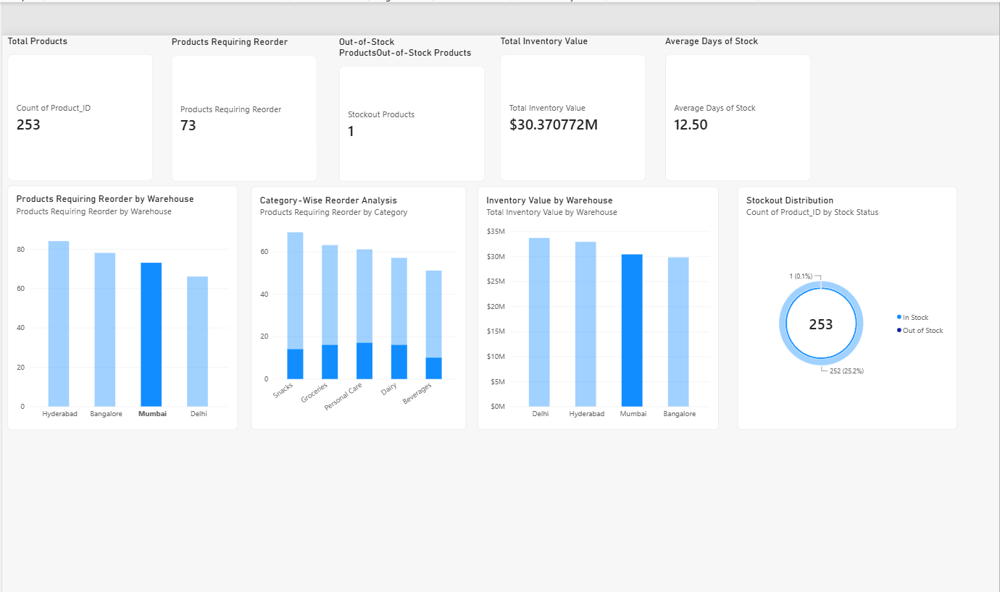

# Inventory Management & Stock Optimization

## Project Overview
Developed an inventory analytics solution using Python, SQL,
and Power BI to identify stockout risks, prioritize
replenishment, and analyze inventory value.

This project uses a synthetic dataset of 1,000 products
distributed across four warehouses.

## Tools & Technologies
- Python (Pandas, NumPy, Matplotlib)
- SQLite and SQL
- Power BI and DAX
- VS Code

## Key Findings
- Total products analyzed: 1,000
- Products requiring reorder: 301 (30.1%)
- Out-of-stock products: 3 (0.3%)
- Total inventory value: INR 126,698,506
- Average days of stock: 13.11

## Warehouse Replenishment Analysis
- Hyderabad: 84 products
- Bangalore: 78 products
- Mumbai: 73 products
- Delhi: 66 products

## Business Recommendations
1. Prioritize replenishment of the three out-of-stock products.
2. Review reorder requirements at Hyderabad and Bangalore.
3. Monitor Snacks and Groceries categories closely.
4. Use supplier lead times and daily demand to plan replenishment.
5. Review inventory value distribution across warehouses.

## Dashboard Preview

## Project Structure
- data/ : Synthetic dataset and SQLite database
- scripts/ : Data generation and analysis
- sql/ : SQL analysis queries
- reports/ : Analytical visualizations
- dashboard/ : Power BI dashboard and screenshot

## Data Disclaimer
All inventory data is synthetic and created for
portfolio demonstration. Findings and recommendations
are illustrative, not measured business outcomes.
